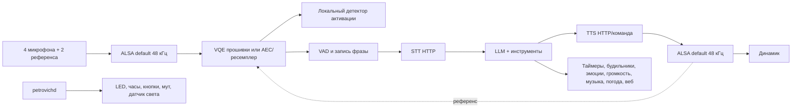

# Петрович — независимый голосовой помощник для Яндекс Станций

`petrovichd` — демон на Rust, который заменяет голосовой стек Яндекса на самой
колонке. Активация происходит локально, речь распознаётся внешним STT, ответ
строит LLM с инструментами, озвучка приходит из TTS и играет через динамик
колонки. Серверного посредника, Home Assistant и облака Яндекса нет.

Поддерживается **Станция Мини 2** (`station-mini2`). Остальные модели
добавляются записью в таблицу профилей, без переписывания логики.

> Статус: код и автоматические тесты готовы; установка на `station-mini2`
> выполнялась, но полный сценарий на конкретной ревизии прошивки нужно
> проверять на устройстве. Что именно проверено, а что требует оборудования, —
> в [docs/testing.md](docs/testing.md). Не считайте непроверенное работающим.

| Проверка | Состояние |
|---|---|
| Тесты workspace, clippy `-D warnings` | проходят на хосте |
| Python-тесты установщика | 7 проходят |
| Модель активации | openWakeWord «Петрович»; загрузка и `--check-config` проверены на колонке |
| Кросс-сборка ARMv7 glibc | собрана ARMv7-сборка glibc 2.23 |
| ALSA/VQE/LED/часы/кнопки/датчик света на колонке | требуют проверки на устройстве |
| Живые STT/LLM/TTS | в тестах mock; реальные API требуют проверки |

## Возможности

- локальная активация по слову (openWakeWord, без облака);
- непрерывный диалог: после ответа можно задать уточняющий вопрос без
  повторной активации;
- прерывание ответа словом активации или кнопкой; голосом поверх озвучки —
  только при `barge_in_voice = true` и рабочем AEC;
- остановка словами «стоп», «хватит», «замолчи» обрабатывается локально,
  без обращения к LLM; после остановки помощник возвращается в ожидание;
- потоковый LLM (SSE) и потоковый PCM-TTS; кэш коротких фраз и синтез
  следующей фразы, пока играет текущая;
- инструменты: время, таймеры и будильники, громкость, музыка через Spotya
  (отдельный инструмент, без Spotya просто не публикуется), эмоции, погода
  в любом городе, поиск, чтение HTTPS-страниц, сброс диалога, остановка;
- вызов инструментов LLM с белым списком и тайм-аутами;
- изолированный запуск кода только при явно настроенной песочнице;
- мягкие служебные звуки и визуальные подтверждения: слушаю, услышал,
  думаю, ответ закончен, остановлено, диалог очищен;
- светодиоды, часы, кнопки и аппаратный мут микрофонов; плавные анимации;
- автояркость кольца и часов по датчику `ltr308als01`;
- установка через ADB/SSH, backup, атомарные релизы, health-check, откат;
- миграция прежних установок `/data/skynet` и `/data/jarvis` в
  `/data/petrovich`;
- отключение Quasar: при падении помощника Алиса автоматически не
  запускается;
- независимые DNS/NTP и проверка отсутствия обращений к Яндексу.

## Модель активации

В релиз входит одна модель — openWakeWord-голова «Петрович»
(`assets/wakeword/petrovich.tflite`). Вместе с `assets/oww.bin` она даёт
локальную активацию по слову «Петрович» без облака. Порог задаётся в
`[wakeword] threshold` (на колонке — 0.5). Других моделей в репозитории нет;
свою можно передать через `--wakeword-model` или `[wakeword] model`.
Подробности — [docs/wakeword-model.md](docs/wakeword-model.md).

## Архитектура



Подробно: [docs/architecture.md](docs/architecture.md), [железо Мини 2](docs/hardware-mini2.md).

## Быстрый старт

Требуется взломанная колонка с root, SSH или ADB. Модель активации «Петрович»
входит в релиз; своя модель нужна только для замены.
Перед первой установкой подготовьте:

1. `config.toml` на основе [config/config.example.toml](config/config.example.toml):
   провайдеры, координаты погоды, инструменты.
2. `secrets.env` на основе [config/secrets.example.env](config/secrets.example.env),
   права `0600`.

Сборка — Rust 1.85+; для ARMv7 используется `cross` или готовый выпуск.

```bash
# На ПК: собрать релиз под ARMv7
cargo install cross --git https://github.com/cross-rs/cross
scripts/build.sh
# dist/petrovichd, dist/petrovichctl, dist/petrovich-assistant-0.2.1-armv7.tar.gz

# Установка по SSH (ключ root уже настроен)
python3 installer/petrovich_install.py --ssh-host station install \
  --config ./config.toml --secrets ./secrets.env
```

Установщик сам кладёт выбранную модель активации в
`/data/petrovich/models/`. Свою модель можно передать явно:

```bash
python3 installer/petrovich_install.py --ssh-host station install \
  --config ./config.toml --secrets ./secrets.env \
  --wakeword-model ./my_wakeword.tflite
```

Для загрузки модели нужен `libtflite.so` из прошивки
(`/system/vendor/quasar/libs/libtflite.so`) либо `libtensorflowlite_c.so`
рядом с `petrovichd`. Встроенная модель «Петрович» — openWakeWord и работает
с `assets/oww.bin`; microWakeWord нужен только для своей модели этого типа.

После установки проверьте на колонке:

```bash
/data/petrovich/current/petrovichctl --config /data/petrovich/config.toml doctor
/data/petrovich/current/petrovichctl --config /data/petrovich/config.toml status
tail -f /data/petrovich/log/petrovichd.log
```

Скажите слово активации, дождитесь мягкого сигнала и задайте вопрос.

## Управление

| Команда | Назначение |
|---|---|
| `petrovichctl status` | процесс, память, релиз, модель |
| `petrovichctl doctor` | ALSA, VQE, кнопки, часы, датчик света, Quasar, DNS, место |
| `petrovichctl logs -n 100` | журнал демона |
| `petrovichctl wake-test file.wav` | прогон модели активации по записи |
| `petrovichctl audio-test 5` | запись с микрофонов и уровни каналов |
| `petrovichctl light-test` | пять отсчётов датчика освещённости |
| `installer ... rollback` | предыдущий релиз и проверка |
| `installer ... restore` | снять помощника и вернуть init-скрипты Quasar |

Установщик и восстановление: [docs/installation.md](docs/installation.md),
[docs/recovery.md](docs/recovery.md).

## Конфигурация и провайдеры

Все параметры — в TOML; секреты — отдельно, с правами `0600`.
Провайдеры STT/LLM/TTS заменяемы: OpenAI-совместимый HTTP, Fish или локальная
команда. HTTPS обязателен, кроме loopback; сертификаты проверяются.
Подробности: [docs/configuration.md](docs/configuration.md),
[docs/providers.md](docs/providers.md).

Инструменты и их ограничения: [docs/security.md](docs/security.md).
Погода — Open-Meteo; координаты по умолчанию и геокодинг задаются в `[tools]`.

## Индикация

- Кольцо: синее «дыхание» при слушании, бегущая точка при размышлении,
  зелёный пульс при ответе, красный при ошибке и муте.
- Часы: плавно мигающее двоеточие; спиннер во время размышления; «8888» после
  ответа, «----» при остановке, «0000» после очистки, «EEEE» при ошибке.
- Звуки: мягкие колокольные сигналы на активацию, конец фразы, ответ,
  остановку, очистку, ошибку, таймер, будильник, эмоции и конец прослушивания.
  Громкость и включение —
  `[dialog] wake_chime` и `state_chimes`.

## Независимость от Яндекса

Установщик отключает автозапуск Quasar шимом init-скрипта. Демон никогда не
запускает Quasar как запасной вариант. `petrovichctl doctor` проверяет, что
`maind`/`quasar_launcher2` не работают, а домены Яндекса не разрешаются.
DNS/NTP задаются отдельно; см. [docs/security.md](docs/security.md).
Полностью исключить сетевые обращения можно только при корректно
настроенных DNS и firewall — это проверяется диагностикой, но не
доказывается ею.

## Разработка

```bash
cargo test --workspace          # 140 тестов
cargo clippy --workspace --all-targets -- -D warnings
python3 -m unittest discover -s installer/tests -v
```

CI собирает ARMv7 glibc 2.23, тестирует на хосте и публикует выпуски по тегу.
Что проверено и чего нельзя проверить без колонки:
[docs/testing.md](docs/testing.md).

## Лицензия

AGPL-3.0-only. Сведения о стороннем коде и моделях —
[THIRD_PARTY_NOTICES.md](THIRD_PARTY_NOTICES.md). Проект не связан с Яндексом;
все действия с устройством — на ваш риск.
