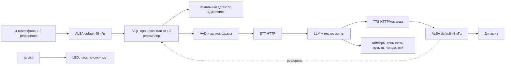

# Джарвис — независимый голосовой помощник для Яндекс Станций

`jarvisd` — демон на Rust, который заменяет голосовой стек Яндекса на самой
колонке. Активация «Джарвис» происходит локально, речь распознаётся внешним
STT, ответ строит LLM с инструментами, озвучка приходит из TTS и играет через
динамик колонки. Серверного посредника, Home Assistant и облака Яндекса нет.

Поддерживается **Станция Мини 2** (`station-mini2`). Остальные модели
добавляются записью в таблицу профилей, без переписывания логики.

> Статус: код и автоматические тесты готовы; на физической колонке этот
> репозиторий ещё не запускался. Что именно проверено, а что требует
> оборудования, — в [docs/testing.md](docs/testing.md). Не считайте
> непроверенное работающим.

| Проверка | Состояние |
|---|---|
| 112 тестов workspace, clippy `-D warnings` | проходят на хосте |
| Совместимость активации с эталоном | 4 реальные записи, те же срабатывания и score |
| Кросс-сборка ARMv7 musl | собрана статическая ARMv7-сборка, запущена под qemu |
| ALSA/VQE/LED/часы/кнопки на колонке | не проверялись здесь |
| Живые STT/LLM/TTS и установка на устройство | не проверялись здесь |

## Возможности

- локальная активация по слову «Джарвис» (модель станции, без облака);
- непрерывный диалог: после ответа можно задать уточняющий вопрос без
  повторной активации;
- прерывание ответа новым «Джарвис»;
- потоковый LLM (SSE) и потоковый PCM-TTS;
- инструменты: время, таймеры, громкость, музыка, погода, поиск, чтение
  HTTPS-страниц, сброс диалога, остановка;
- вызов инструментов LLM с белым списком и тайм-аутами;
- изолированный запуск кода только при явно настроенной песочнице;
- светодиоды, часы, кнопки и аппаратный мут микрофонов;
- установка через ADB/SSH, backup, атомарные релизы, health-check, откат;
- отключение Quasar: при падении помощника Алиса автоматически не
  запускается;
- независимые DNS/NTP и проверка отсутствия обращений к Яндексу.

## Архитектура



Подробно: [docs/architecture.md](docs/architecture.md), [железо Мини 2](docs/hardware-mini2.md).

## Быстрый старт

Требуется взломанная колонка с root, SSH или ADB, и совместимая модель.
Сборка — Rust 1.85+; для ARMv7 используется `cross` или готовый выпуск.

```bash
# На ПК: собрать релиз под ARMv7
cargo install cross --git https://github.com/cross-rs/cross
scripts/build.sh
# dist/jarvisd, dist/jarvisctl, dist/jarvis-station-0.1.0-armv7.tar.gz

# Установка по SSH (ключ root уже настроен)
python3 installer/jarvis_install.py --ssh-host station upgrade

# Или по ADB
python3 installer/jarvis_install.py --transport adb install
```

Перед первой установкой подготовьте:

1. `config.toml` на основе [config/config.example.toml](config/config.example.toml):
   провайдеры, координаты погоды, инструменты.
2. `secrets.env` на основе [config/secrets.example.env](config/secrets.example.env),
   права `0600`.
3. Модель активации `wakeword.json` — см.
   [docs/wakeword-model.md](docs/wakeword-model.md). Модель, обученная на голосе
   владельца, в репозиторий не входит; установщик умеет импортировать её из
   прежней установки `/data/opt/wakeword/model.json`.

```bash
python3 installer/jarvis_install.py --ssh-host station install \
  --config ./config.toml --secrets ./secrets.env \
  --wakeword-model ./wakeword.json
```

После установки проверьте на колонке:

```bash
/data/jarvis/current/jarvisctl --config /data/jarvis/config.toml doctor
/data/jarvis/current/jarvisctl --config /data/jarvis/config.toml status
tail -f /data/jarvis/log/jarvisd.log
```

Скажите «Джарвис», дождитесь сигнала и задайте вопрос.

## Управление

| Команда | Назначение |
|---|---|
| `jarvisctl status` | процесс, память, релиз, модель |
| `jarvisctl doctor` | ALSA, VQE, кнопки, часы, Quasar, DNS, место |
| `jarvisctl logs -n 100` | журнал демона |
| `jarvisctl wake-test file.wav` | прогон модели активации по записи |
| `jarvisctl audio-test 5` | запись с микрофонов и уровни каналов |
| `installer ... rollback` | предыдущий релиз и проверка |
| `installer ... restore` | снять помощника и вернуть init-скрипты Quasar |

Установщик и восстановление: [docs/installation.md](docs/installation.md),
[docs/recovery.md](docs/recovery.md).

## Конфигурация и провайдеры

Все параметры — в TOML; секреты — отдельно, с правами `0600`.
Провайдеры STT/LLM/TTS заменяемы: OpenAI-совместимый HTTP или локальная
команда. HTTPS обязателен, кроме loopback; сертификаты проверяются.
Подробности: [docs/configuration.md](docs/configuration.md),
[docs/providers.md](docs/providers.md).

Инструменты и их ограничения: [docs/security.md](docs/security.md).
Погода — Open-Meteo, координаты задаются в `[tools]`.

## Независимость от Яндекса

Установщик отключает автозапуск Quasar шимом init-скрипта. Демон никогда не
запускает Quasar как запасной вариант. `jarvisctl doctor` проверяет, что
`maind`/`quasar_launcher2` не работают, а домены Яндекса не разрешаются.
DNS/NTP задаются отдельно; см. [docs/security.md](docs/security.md).
Полностью исключить сетевые обращения можно только при корректно
настроенных DNS и firewall — это проверяется диагностикой, но не
доказывается ею.

## Разработка

```bash
cargo test --workspace          # 112 тестов
cargo clippy --workspace --all-targets -- -D warnings
python3 -m unittest discover -s installer/tests -v
```

CI собирает ARMv7 musl, тестирует на хосте и публикует выпуски по тегу.
Что проверено и чего нельзя проверить без колонки:
[docs/testing.md](docs/testing.md).

## Лицензия

AGPL-3.0-only. Сведения о стороннем коде и моделях —
[THIRD_PARTY_NOTICES.md](THIRD_PARTY_NOTICES.md). Проект не связан с Яндексом;
все действия с устройством — на ваш риск.
