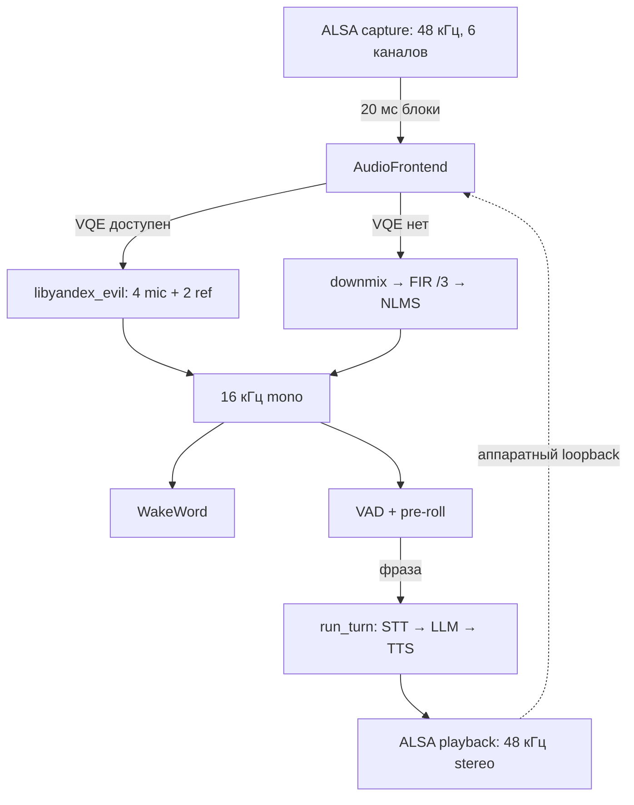
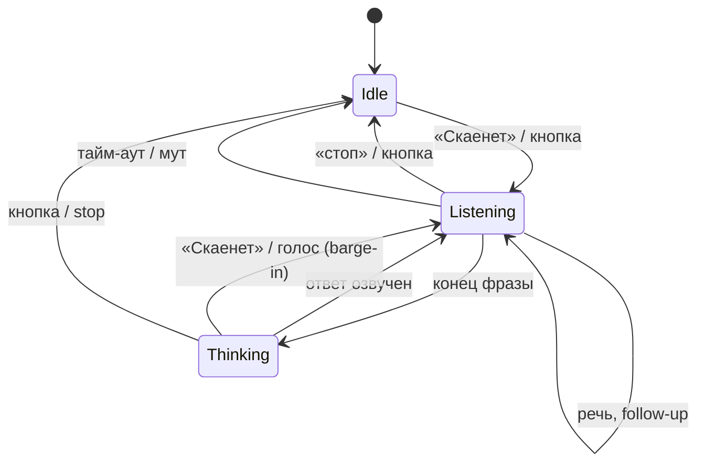

# Архитектура

## Крейты

| Крейт | Ответственность |
|---|---|
| `skynet-core` | конфигурация, секреты, история, WAV, профили моделей, типы сообщений |
| `skynet-audio` | ALSA через dlopen, VQE, AEC, VAD, ресемплинг, громкость, звуки |
| `skynet-wakeword` | microWakeWord/TFLite и openWakeWord-совместимый бэкенд |
| `skynet-providers` | STT, LLM (SSE, tool calls), TTS (PCM/WAV, поток) |
| `skynet-tools` | таймеры, громкость, музыка, погода, веб, песочница |
| `skynet-hw` | светодиоды, часы, кнопки evdev, GPIO-мут, датчик света |
| `skynetd` | голосовой автомат, конфигурация, жизненный цикл |
| `skynetctl` | диагностика без запуска аудио |

Зависимости направлены вниз: `skynetd` знает все крейты, но ни один крейт не
зависит от демона. Провайдеры и инструменты тестируются без ALSA и колонки.

## Поток звука

`AudioFrontend` накапливает чанки VQE ровно того размера, который требует
пресет прошивки (`YandexVqeC_Config_GetInputChunkSize`). При ошибке VQE тракт
переключается на собственный DSP и больше не возвращается к библиотеке до
перезапуска.

Собственный DSP: среднее четырёх микрофонов, КИХ-дециматор 48→16 кГц (63
tap, срез 7,2 кГц), NLMS-эхоподавление по аппаратному референсу каналов 4/5,
адаптивный шумовой затвор, энергетический VAD с адаптивным шумом и 300 мс
калибровкой.

## Голосовой автомат

- `Idle`: кадры идут только в детектор активации.
- `Listening`: VAD собирает фразу; тайм-аут после активации —
  `dialog.listen_timeout_ms`, после ответа — `follow_up_ms`.
- `Thinking`: задача `run_turn` делает STT, LLM и TTS. Детектор продолжает
  слушать для barge-in; при срабатывании задача `abort()`, очередь
  воспроизведения очищается. Дополнительно VAD ловит речь поверх озвучки и
  сразу останавливает ответ. Команды «стоп», «хватит», «замолчи», «отмена»
  распознаются локально без LLM и возвращают автомат в `Idle`; кнопка
  действия в `Thinking` делает то же.
- `Speaking` отображается на индикации через `UiEvent::SpeechStarted`, но
  состояние автомата остаётся `Thinking`: отмена и тайм-ауты одинаковы.

История диалога хранится в памяти: не более `history_turns` ходов,
`history_chars` символов и `history_ttl_s` секунд. Обрезка удаляет ход
целиком, чтобы `tool_call` не остался без результата.

## Индикация и обратная связь

Демон отправляет в `skynet-hw` два вида событий:

- `UiEvent::State` — долговременное состояние (`Idle`, `Listening`,
  `Thinking`, `Speaking`, `Error`);
- `UiEvent::Notice` — короткое подтверждение (`Listening`, `Heard`, `Done`,
  `Stopped`, `Cleared`, `Error`, `Timer`).

`skynet-hw` обновляет кольцо и часы каждые 20 мс. Цвета кольца считаются по
времени, а не по номеру кадра, и интерполируются между кадрами: переход
«слушаю → думаю» не выглядит рывком. Двоеточие часов получает отдельную
яркость и гаснет/загорается по косинусу. Во время `Thinking` по сегментам
идёт спиннер; короткие события показывают `8888`, `----`, `0000`, `EEEE`.

Служебные звуки генерируются локально: колокольная атака 18 мс, длинный
release 90 мс и экспоненциальный спад. Сигналы активации, «услышал», ответа,
остановки, очистки, ошибки и таймера различаются интервалами, а не громкостью.

Если датчик `ltr308als01` найден, `skynet-hw` раз в секунду читает люксы и
плавно меняет яркость кольца и часов; иначе остаются фиксированные
`led_brightness`/`clock_brightness`. Ошибка любого компонента отключает
только его, голосовой тракт продолжает работать.

## Потоки

- `skynet-capture` — блокирующее чтение ALSA, отправка блоков в tokio-канал.
- `skynet-playback` — очередь PCM, ресемплинг в 48 кГц, запись в ALSA;
  поколение очереди отбрасывает старые буферы после `stop()`.
- `skynet-buttons` — блокирующее чтение evdev.
- `skynet-mute` — опрос GPIO раз в 400 мс.
- tokio-задачи: UI/анимации, таймеры, один ход диалога, объявления.

VQE и NLMS используются одним потоком обработки; общих блокировок нет.
Захват и вывод обмениваются только каналами.

## Ошибки и отказы

- LLM/TTS/STT: тайм-ауты, до `retries` повторов на 429/5xx, ошибка
  возвращается в автомат; играет звук ошибки, помощник снова слушает.
- Аудио: ошибка чтения/записи логируется, поток восстанавливается через
  `snd_pcm_recover`; при повторных ошибках — пауза 200 мс.
- VQE/светодиоды/часы: деградация по компоненту, демон продолжает работу.
- Супервизор: до 5 падений подряд, затем остаётся остановленным. Quasar не
  запускается.

## Расширение на другие модели

`skynet-core::profile` — таблица `HardwareProfile`: каналы, VQE-пресет,
префикс LED, пути часов, GPIO мута, кнопка действия. Для новой модели
добавляется запись и `supported = true`; логика демона не меняется.
Неизвестная модель останавливает запуск с понятной ошибкой.
