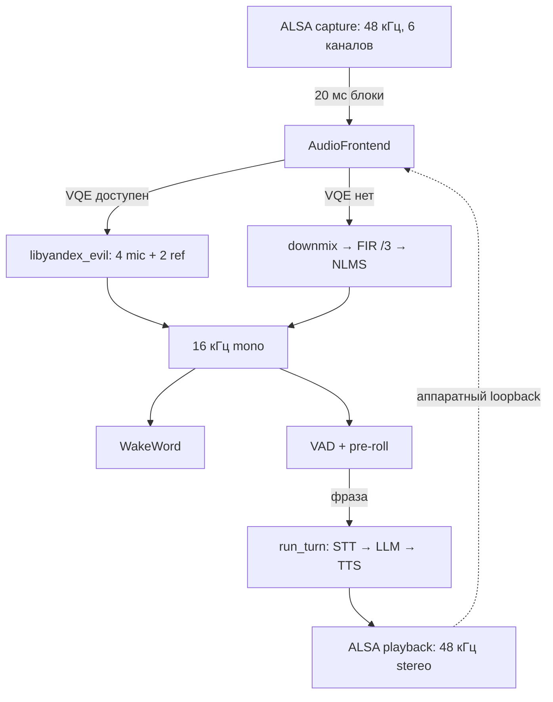
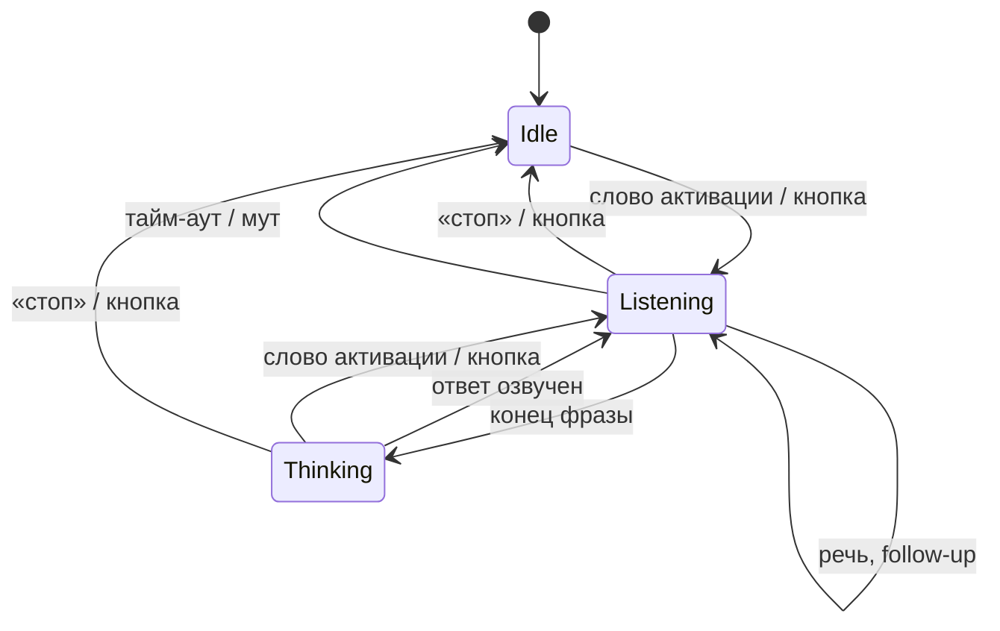

# Архитектура

## Крейты

| Крейт | Ответственность |
|---|---|
| `petrovich-core` | конфигурация, секреты, история, WAV, профили моделей, типы сообщений |
| `petrovich-audio` | ALSA через dlopen, VQE, AEC, VAD, ресемплинг, громкость, звуки |
| `petrovich-wakeword` | microWakeWord/TFLite и openWakeWord-совместимый бэкенд |
| `petrovich-providers` | STT, LLM (SSE, tool calls), TTS (PCM/WAV, поток) |
| `petrovich-tools` | таймеры, громкость, Spotify/YouTube, погода, сахар, Tuya, Tavily, песочница |
| `petrovich-hw` | светодиоды, часы, кнопки evdev, GPIO-мут, датчик света |
| `petrovichd` | голосовой автомат, librespot, ByeDPI, декодер YouTube, жизненный цикл |
| `petrovichctl` | диагностика без запуска аудио |

Зависимости направлены вниз: `petrovichd` знает все крейты, но ни один крейт не
зависит от демона. Провайдеры и инструменты тестируются без ALSA и колонки.
Медиа-модули живут в `petrovichd`: Spotify Connect (librespot), встроенный
SOCKS5 ByeDPI и декодер YouTube пишут звук в тот же ALSA `default`.
Для SOCKS5 librespot внутри процесса поднимается HTTP CONNECT-мост на
loopback: librespot видит обычный HTTP-прокси, а мост идёт в SOCKS5. Отдельных
процессов `spotifyd`, `ciadpi`, `mpv` или `yt-dlp` нет. Модуль, выключенный в
`[modules]`, не создаёт клиентов, потоков и фоновых задач.

## Поток звука

`AudioFrontend` накапливает чанки VQE ровно того размера, который требует
пресет прошивки (`YandexVqeC_Config_GetInputChunkSize`). При ошибке VQE тракт
переключается на собственный DSP и больше не возвращается к библиотеке до
перезапуска.

Собственный DSP: среднее четырёх микрофонов, КИХ-дециматор 48→16 кГц (63
tap, срез 7,2 кГц), NLMS-эхоподавление по аппаратному референсу каналов 4/5,
адаптивный шумовой затвор, энергетический VAD с адаптивным шумом. Первые
кадры речи сразу входят во фразу; короткая команда завершается по
`short_silence_ms`, длинная ждёт `silence_ms`, а пауза до `resume_pause_ms`
не разрывает предложение.

TTS: короткие служебные фразы кэшируются (не больше 32), следующая фраза
синтезируется параллельно с проигрыванием текущей. Перед завершением хода
демон ждёт `snd_pcm_drain`: следующий вопрос можно задавать сразу после
ответа, не дожидаясь хвоста буфера ALSA.

## Голосовой автомат

- `Idle`: кадры идут только в детектор активации.
- `Listening`: VAD собирает фразу; тайм-аут после активации —
  `dialog.listen_timeout_ms`, после ответа — `follow_up_ms`.
- `Thinking`: задача `run_turn` делает STT, LLM и TTS. Детектор продолжает
  слушать для barge-in; при срабатывании задача `abort()`, очередь
  воспроизведения очищается. Голос поверх озвучки включается отдельно
  (`barge_in_voice = true`) и требует рабочего AEC: без него бардж-ин по
  голосу и слову активации блокируется, иначе ассистент обрывает сам себя.
  Команды «стоп», «хватит», «замолчи», «отмена» распознаются
  локально без LLM и возвращают автомат в `Idle`; кнопка действия в
  `Thinking` делает то же. «Повтори» и «скажи ещё раз» озвучивают последний
  ответ без запроса к LLM.
- Объявления вне хода (таймер, будильник, «не понял») идут одной звуковой
  дорожкой: новое объявление вытесняет предыдущее, а «стоп», кнопка и мут
  прерывают его так же, как обычный ответ. Поэтому звонящий будильник можно
  выключить голосом или кнопкой, не дожидаясь конца фразы.
- `Speaking` отображается на индикации через `UiEvent::SpeechStarted`, но
  состояние автомата остаётся `Thinking`: отмена и тайм-ауты одинаковы.

VAD оценивает шумовую полку по нижнему децилю двухсекундного окна и обновляет
её фоном ещё в `Idle`. После активации порог на всё окно ожидания команды
(`activation_boost_ms`) снижается на `activation_boost_db`: говорить громче
не нужно. Послабление ограничено снизу шумовой полкой +3 дБ, иначе колебания
фона принимаются за речь. Начатую фразу VAD удерживает ещё на 3 дБ ниже, чтобы
тихие слоги не обрывали слово. Порог и шумовая полка пишутся в журнал при
активации.

История диалога хранится в памяти: не более `history_turns` ходов,
`history_chars` символов и `history_ttl_s` секунд. Обрезка удаляет ход
целиком, чтобы `tool_call` не остался без результата.

Долговременная память — отдельный файл `<state_dir>/memory.json` с правами
`0600`. Факты добавляет инструмент `remember`, удаляет `forget`; `reset_dialog`
чистит только историю. Перед каждым ходом самые свежие факты в пределах
`memory.prompt_chars` дописываются в системное сообщение, а `remember`
атомарно перезаписывает файл. Поэтому факты не теряются при перезапуске, но
и не раздувают контекст бесконечно.

## Индикация и обратная связь

Демон отправляет в `petrovich-hw` два вида событий:

- `UiEvent::State` — долговременное состояние (`Idle`, `Listening`,
  `Thinking`, `Speaking`, `Error`);
- `UiEvent::Notice` — короткое подтверждение (`Listening`, `Heard`, `Done`,
  `Stopped`, `Cleared`, `Error`, `Timer`).

`petrovich-hw` обновляет кольцо и часы каждые 20 мс. Цвета кольца считаются по
времени, а не по номеру кадра, и интерполируются между кадрами: переход
«слушаю → думаю» не выглядит рывком. Двоеточие часов получает отдельную
яркость и гаснет/загорается по косинусу. Во время `Listening` на экране
горит `СЛУ` и шкала уровня, во время `Thinking` по сегментам идёт спиннер;
короткие события показывают `8888`, `----`, `0000`, `EEEE`.

Служебные звуки генерируются локально: колокольная атака 18 мс, длинный
release 90 мс и экспоненциальный спад. Сигналы активации, «услышал», ответа,
остановки, очистки, ошибки и таймера различаются интервалами. При Master ниже
70% к сигналу добавляется до +12 дБ цифровой компенсации, чтобы он не терялся
на тихой колонке; выше 70% усиления нет. Выход по-прежнему проходит через
ALSA Master, системную громкость демон не меняет.

Если датчик `ltr308als01` найден, `petrovich-hw` раз в секунду читает люксы и
плавно меняет яркость кольца и часов; иначе остаются фиксированные
`led_brightness`/`clock_brightness`. Ошибка любого компонента отключает
только его, голосовой тракт продолжает работать.

## Потоки

- `petrovich-capture` — блокирующее чтение ALSA, отправка блоков в tokio-канал.
- `petrovich-playback` — очередь PCM, ресемплинг в 48 кГц, запись в ALSA;
  поколение очереди отбрасывает старые буферы после `stop()`.
- `petrovich-buttons` — блокирующее чтение evdev.
- `petrovich-mute` — опрос GPIO раз в 400 мс.
- tokio-задачи: UI/анимации, таймеры, один ход диалога, объявления.

VQE и NLMS используются одним потоком обработки; общих блокировок нет.
Захват и вывод обмениваются только каналами.

## Ошибки и отказы

- LLM/TTS/STT: тайм-ауты, до `retries` повторов на 429/5xx, ошибка
  возвращается в автомат; играет звук ошибки, помощник снова слушает.
- Аудио: ошибка чтения/записи логируется, поток восстанавливается через
  `snd_pcm_recover`; при повторных ошибках — пауза 200 мс.
- VQE/светодиоды/часы: деградация по компоненту, демон продолжает работу.
- Супервизор: падения и зависания (heartbeat не обновлялся дольше 60 с)
  поднимают демон заново; пауза между быстрыми падениями растёт до 60 с.
  Quasar не запускается: это обеспечивает шим `enabled`.

## Расширение на другие модели

`petrovich-core::profile` — таблица `HardwareProfile`: каналы, VQE-пресет,
префикс LED, пути часов, GPIO мута, кнопка действия. Для новой модели
добавляется запись и `supported = true`; логика демона не меняется.
Неизвестная модель останавливает запуск с понятной ошибкой.
